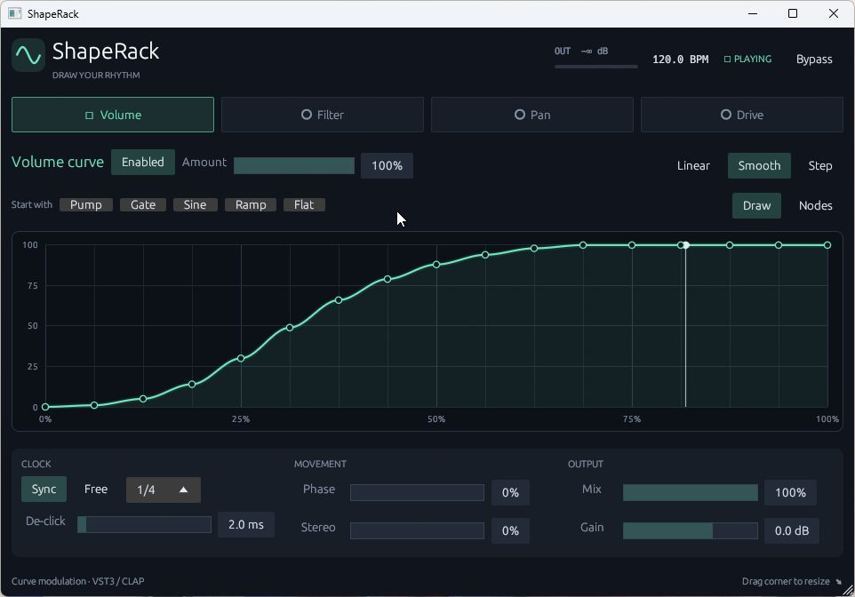

# ShapeRack

Download the [v0.2.2 Windows installer or ZIP](https://github.com/0xPRISMM/shaperack/releases/tag/v0.2.2), with improved filter and drive processing, saveable/shareable rack presets, and a default Bend tool that edits both points and segment curves.

An original Rust modulation rack for **Windows x64 VST3 and CLAP** hosts. Draw a rhythm and use it to animate volume, a low-pass filter, stereo balance, or soft saturation. Designed for FL Studio mixer inserts.

ShapeRack is an independent project inspired by drawable modulation effects. It is not affiliated with Cableguys and does not use ShaperBox source code, artwork, or presets.



## Features

- Four independently editable modules in a fixed chain: **Volume → Filter → Pan → Drive**.
- Seventeen points at fixed time positions per module, with **Nodes, Draw, Line, and Bend** editing tools and sixteen adjustable segment bends.
- Linear, smoothstep, and step interpolation; Pump, Gate, Sine, Ramp, and Flat curve starters.
- Vertical snapping, fine adjustment, curve undo/redo, copy/paste, invert, reverse, and flatten tools.
- Five factory rack presets, a personal preset library, and portable JSON import/export.
- A smoothed 12 dB/octave Butterworth low-pass and antialiased soft saturation.
- Host tempo sync from 1/32 note to 16 beats; free-running rate from 0.05–20 Hz.
- Host seek/loop alignment, global phase shift, and right-channel phase offset.
- Adjustable de-click smoothing, per-module amount and enable controls, dry/wet mix, output gain, and smoothed bypass.
- Automatable curve points, segment bends, and controls, saved with the DAW project.
- Mono/stereo audio, zero reported latency, native resizable editor and live output meter.

## Install in FL Studio

**[Download ShapeRack 0.2.2 Setup for Windows x64 (.exe)](https://github.com/0xPRISMM/shaperack/releases/download/v0.2.2/ShapeRack-0.2.2-Setup.exe)**

Close your DAW, run the setup EXE, and approve the administrator prompt. Setup installs the VST3 plugin in the standard Common Files location, offers an optional CLAP component, and adds a Windows uninstaller. Then scan for plugins in FL Studio and load ShapeRack in a mixer effect slot. No Rust or build tools are needed to install the release.

The installer is unsigned, so Windows may display an unknown-publisher notice. A [ZIP package for manual installation](https://github.com/0xPRISMM/shaperack/releases/tag/v0.2.2) is also available. See [INSTALL.md](INSTALL.md) for paths, scanning, updates, and removal. FL Studio 2025 checks with the v0.2.0 VST3 confirmed signal activity during playback, stopped note previews, combined source routing, and preset import/export. These checks used meters and waveform displays; speaker listening and FL project save/reopen remain untested. See [VALIDATION.md](VALIDATION.md) for version-specific coverage.

## Quick start

1. Put ShapeRack on a sustained bass, pad, or synth mixer channel.
2. Choose **Quarter-note pump** from **RACK PRESET** for a duck on every quarter-note beat.
3. In the default **Bend** mode, drag a curve point up or down to change its value, or drag a segment diamond to bend the line between points. Choose **Draw** from the tool dropdown to paint across the curve.
4. Select Filter, Pan, or Drive, then click its **Filter OFF**, **Pan OFF**, or **Drive OFF** button to turn it on. The button lights up and says **ON**. Each tab has its own curve; all modules share the clock.
5. Adjust Amount, Mix, and De-click to taste. Pan has no effect on mono audio.

The curve resets each cycle, so a mismatched start/end value can click at zero De-click. Use smoothing for pump/gate shapes. **Sync** follows the project tempo and keeps cycling when you preview notes with transport stopped; the header says **SYNC PREVIEW**. Pressing Play realigns the curve with the song position and changes the status to **SYNC PLAYING**. **Free** runs at the selected speed in Hz. If host tempo is unavailable, Sync uses 120 BPM; if song position is unavailable, it continues its internal tempo clock.

## Edit curves

Bend is the default tool when the editor opens. It lets you edit points and segment bends without changing tools. Nodes, Draw, and Line remain available in the tool dropdown.

| Tool | Gesture |
| --- | --- |
| Nodes | Drag points vertically. Hold **Shift** for fine adjustment; double-click a point to blend it into its neighbours. |
| Draw | Paint across the graph; values between crossed points are filled in. |
| Line | Drag from the start to the end of a straight ramp. |
| Bend | Drag directly on a curve point to move it vertically; double-click a point to blend it into its neighbours. Drag a segment diamond to change its curvature; double-click a diamond to straighten. **Alt-drag** bends a segment from the other tools. |

In Bend mode, the pointer stays an arrow over blank graph space and changes to a vertical editing cursor over a point or segment diamond. The 17 point times stay at sixteen equal divisions of the selected cycle. **Snap** controls vertical values: Off, 1/4, 1/8, or 1/16. **Ctrl** temporarily enables quarter snapping when Snap is off; **Shift** bypasses snapping and gives fine control for Nodes and Bend. Bending a Step curve switches it to Linear so the bend can be heard.

Use **Undo** and **Redo** for the selected module's curve edits. **Tools** offers Copy curve, Paste curve, Invert vertically, Reverse in time, Smooth points, Clear segment bends, and Flatten to neutral. Copy/paste includes bends and interpolation. The **Shape** buttons replace only the selected module's curve; the **RACK PRESET** menu recalls the complete rack.

## Save and share presets

The **RACK PRESET** dropdown contains five factory sounds—Clean rack, Quarter-note pump, Slow filter sweep, Stereo sway, and Warm rhythmic drive—plus **My presets**. An asterisk beside the current name indicates edits.

| Control | What it does |
| --- | --- |
| Save... | Open the naming box and save the current rack to your personal library. |
| Import... | Choose a portable `.shaperack.json` file in the native file dialog and load it. Use **Save...** afterward to add it to My presets. |
| Export... | Choose a destination in the native save dialog to share or back up the current rack as `.shaperack.json`. |
| Refresh | Reload the library to see presets saved by another ShapeRack instance. |

The installer creates `%APPDATA%\PRISMM\ShapeRack\Presets` and includes the five portable factory presets in its `Factory` subfolder. The plugin also creates this folder on first opening, including ZIP installations. Existing files are preserved during updates and uninstall. Preset files contain all 153 audio parameters, including module enables, curves, bends, timing, Mix, Output, and Bypass. They leave the editor window size alone. Your DAW project also stores the current rack, independently of exported preset files. Uninstalling ShapeRack retains your personal preset library.

## Build from source

Install current stable Rust and the Windows Visual Studio C++ build tools, then:

```powershell
cargo test --locked --lib
cargo xtask bundle shaperack --release --locked
powershell -NoProfile -File scripts/package.ps1 -Version 0.2.2
```

The bundled VST3 and CLAP files are in `target/bundled/`; the ZIP is in `dist/`. The dependency lockfile and required NIH-plug sources are checked in. [Vendor notes](vendor/README.md) describe the small CLAP automation timing fix applied to the framework.

To build the setup EXE, also install [Inno Setup 6](https://jrsoftware.org/isinfo.php), then run the installer script after `scripts/package.ps1`:

```powershell
powershell -NoProfile -File scripts/build-installer.ps1
```

This creates `dist/ShapeRack-0.2.2-Setup.exe`. If the compiler is in a custom location, pass `-InnoCompiler 'C:\path\to\ISCC.exe'`. Building the installer does not install the plugin on your machine.

For a native editor preview without a DAW (dummy backend produces no audio):

```powershell
cargo run --locked --features standalone --bin shaperack-preview -- --backend dummy
```

GitHub Actions checks formatting, linting, Rust tests, and the real CLAP and VST3 binaries, then builds Windows packages and the setup EXE. It verifies default/full installation and uninstallation in staging. Version tags publish the Windows ZIP and setup EXE as GitHub releases. Check workflow run results for CI status; the commands above also support local builds.

## Release scope

Version 0.2.2 remains experimental. The filter uses a smoothed two-pole Butterworth state-variable design. Drive uses first-order antiderivative antialiasing (ADAA) to reduce folded harmonics; strong drive can still alias, and the wet signal has mild high-frequency smoothing and approximately half a sample of phase delay. It adds no buffered integer-sample latency. The DSP implementations reference [Cytomic's filter derivation](https://cytomic.com/files/dsp/SvfLinearTrapOptimised2.pdf) and the [DAFx antiderivative antialiasing paper](https://dafx.de/paper-archive/2025/DAFx25_paper_30.pdf).

Pan controls stereo balance. Bar labels assume four quarter-note beats. Modules share one clock and their order is fixed. Curve nodes stay at fixed time positions. This version does not include multiband processing, audio/MIDI triggering, time warping, or envelope followers.

See [VALIDATION.md](VALIDATION.md) for checks actually performed and remaining host validation.

## License and credits

GPL-3.0-or-later; see [LICENSE](LICENSE). Uses [NIH-plug](https://github.com/robbert-vdh/nih-plug) (ISC), [egui](https://github.com/emilk/egui) (MIT/Apache-2.0), and the framework's GPLv3 VST3 bindings. See [THIRD_PARTY.md](THIRD_PARTY.md).

The curve editor interaction review referenced [Wolf Shaper's graph widget](https://github.com/wolf-plugins/wolf-shaper/blob/master/src/Widgets/src/GraphWidget.cpp) and [documented tension-handle gestures](https://wolf-plugins.github.io/wolf-shaper/). ShapeRack uses its own Rust implementation, fixed time grid, and curve calculations; no Wolf Shaper code or assets are included.

The stopped-transport timing review also examined [GATE-12's processor](https://github.com/tiagolr/gate12/blob/master/src/PluginProcessor.cpp), which separates playing host-position alignment from continuous per-sample clock advancement. ShapeRack's preview behavior and tests are implemented independently; no GATE-12 code or assets are included.
